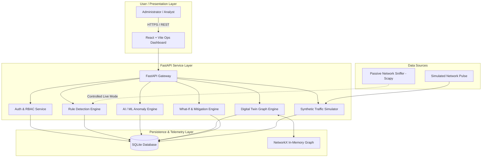
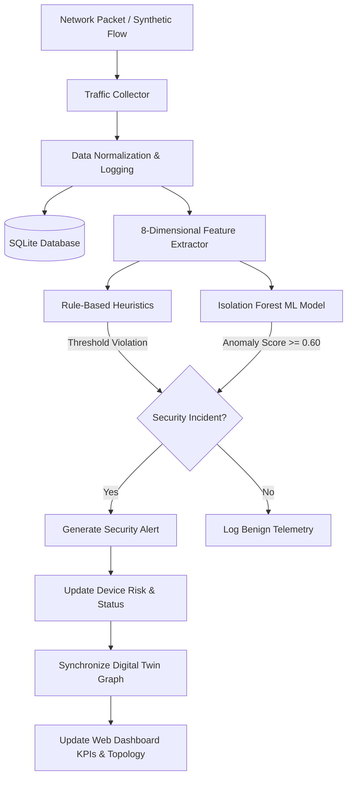
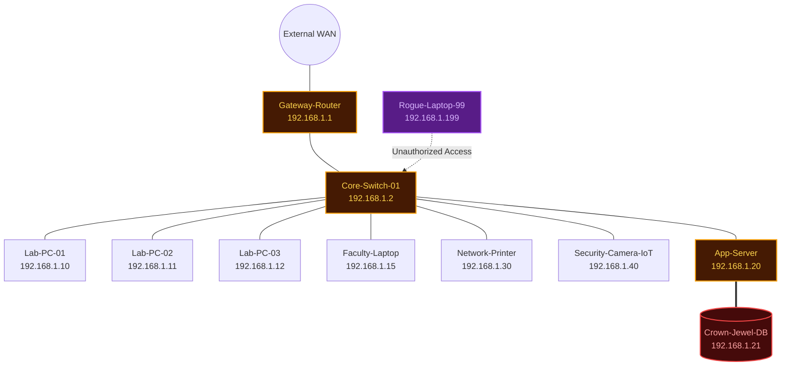
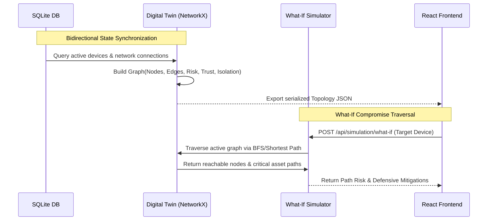
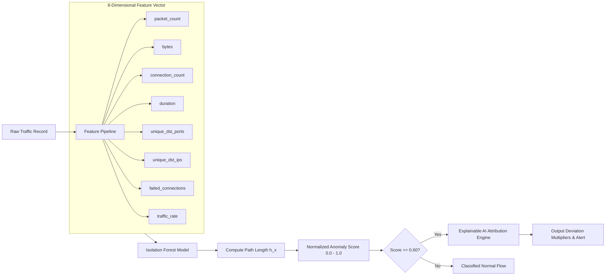
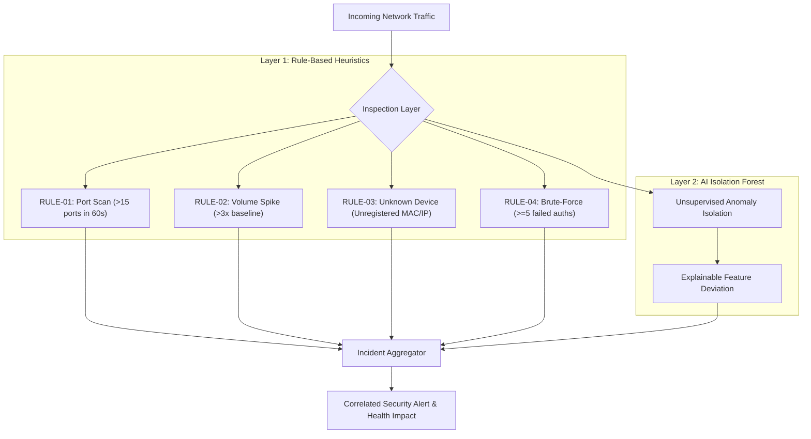
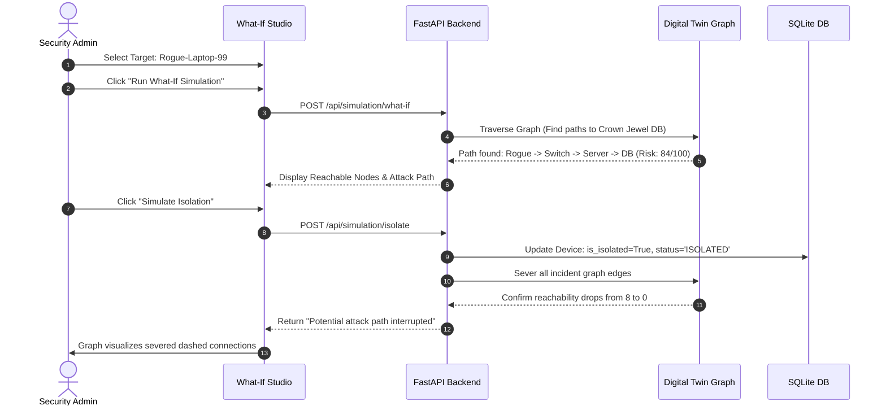
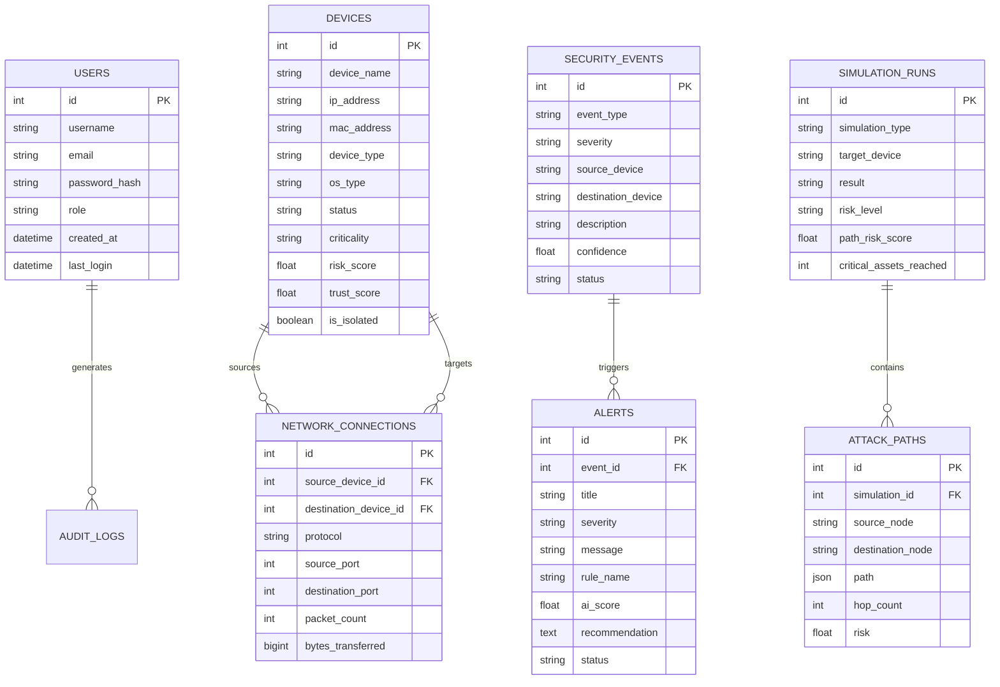
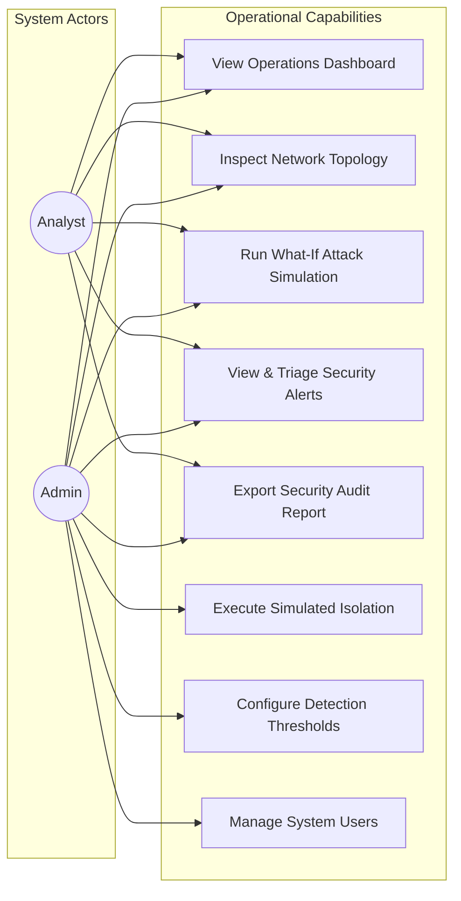
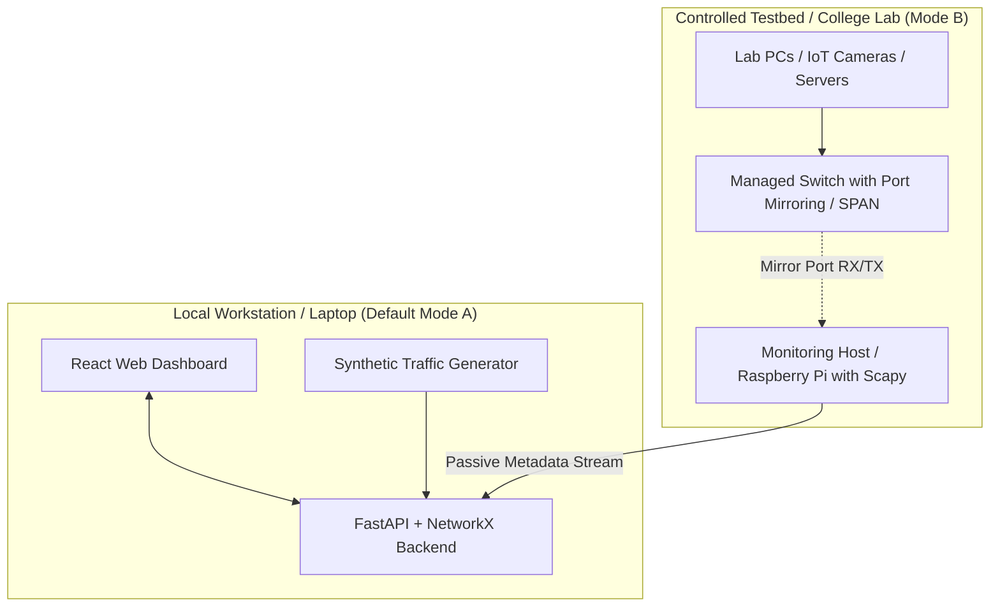

# NetGuardian Architecture & System Design Diagrams

This document contains Mermaid diagrams illustrating all 10 architectural views specified in the NetGuardian Master Specification.

---

## 1. System Architecture Diagram

---

## 2. End-to-End Data Flow Diagram

---

## 3. Network Topology Architecture

---

## 4. Digital Twin Engine Synchronization

---

## 5. AI / ML Anomaly Detection Pipeline

---

## 6. Multi-Layer Threat Detection Engine

---

## 7. What-If Simulation & Simulated Isolation Flow

---

## 8. Database Entity-Relationship (ER) Diagram

---

## 9. Role-Based Access Control (Use Case Diagram)

---

## 10. Deployment Topology (Simulation vs Controlled Real Network)

